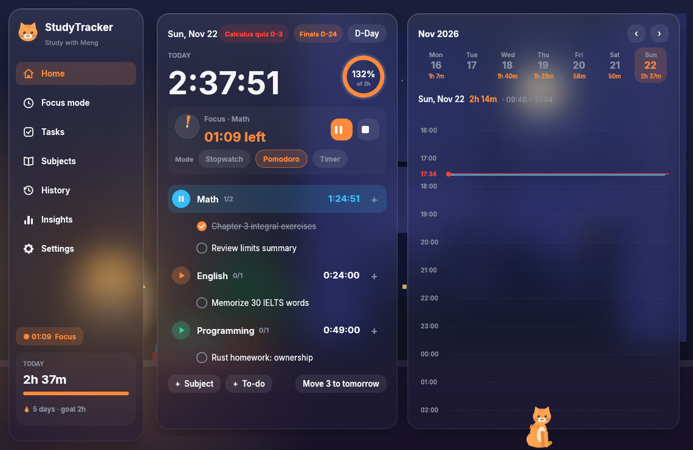
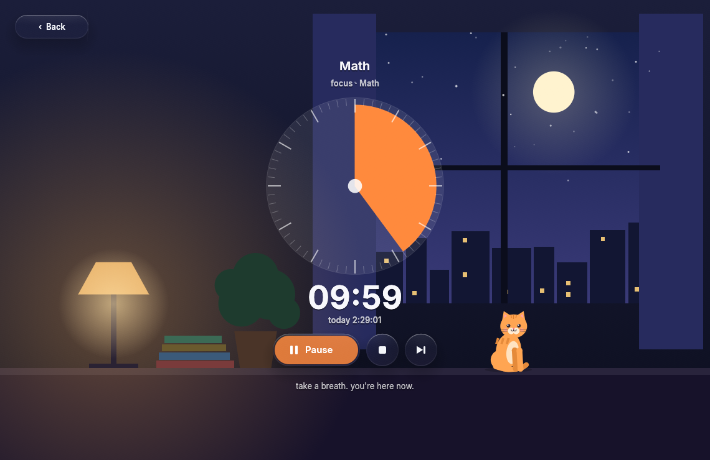
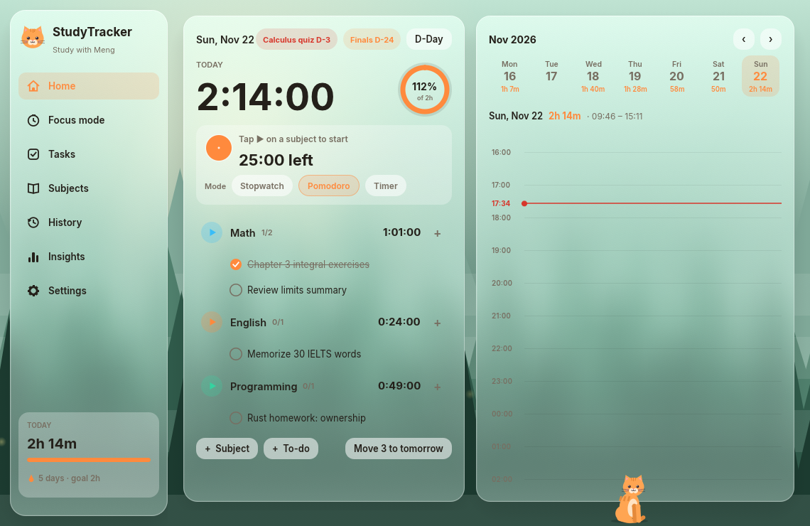
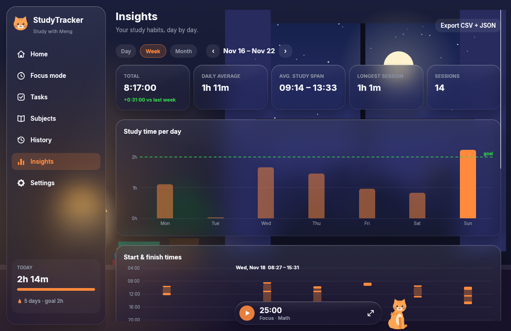
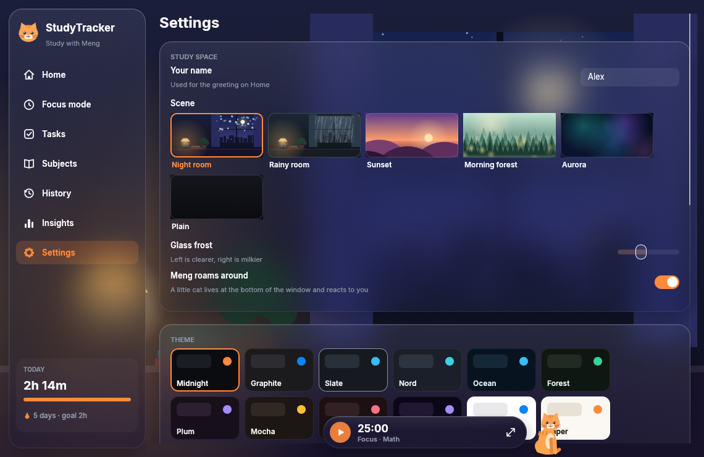
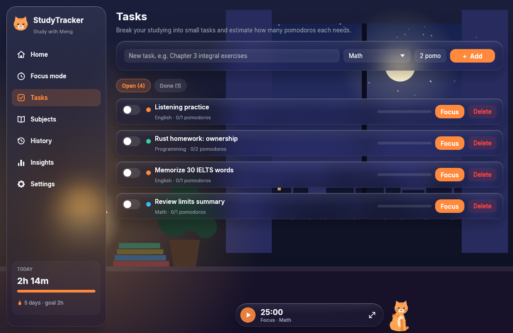
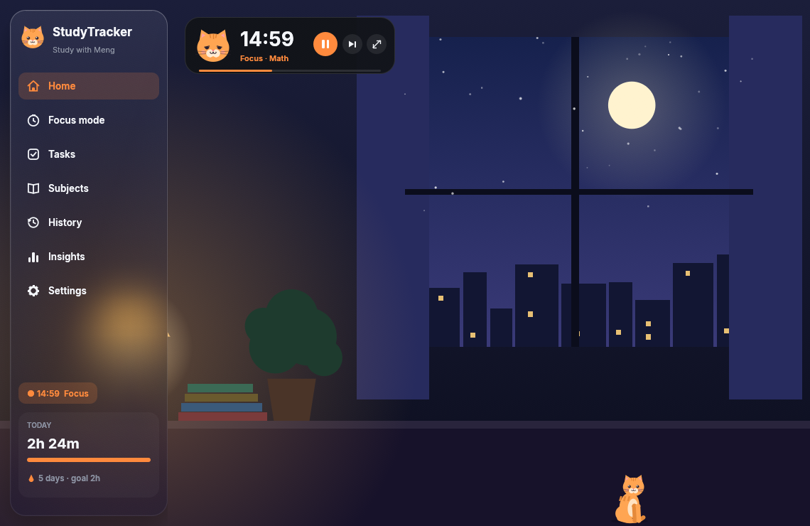
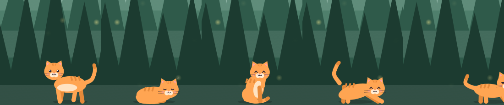

# StudyTracker

A calm, personal study timer for the Windows desktop, with **Meng**, a little orange cat who lives at the bottom of your window.
Built with Rust and [egui/eframe](https://github.com/emilk/egui). All data stays offline on your computer.



StudyTracker mixes two ideas: a YPT-style study log (today's total, one-tap timers per subject, a day planner)
and a quiet study space (a scene behind frosted glass, an immersive focus mode). It is personal only, so there
are no groups or rankings.

## Features

**Home**
- Today's total in big digits with a ring for your daily goal.
- The current session: a "time left" clock, start/pause/stop, and the timer mode.
- Subjects with a play button each, today's time per subject, and per-day to-dos under each subject.
  Unfinished to-dos can be moved to tomorrow in one click.
- D-Day countdowns for exams and deadlines.
- A planner: a week strip, a summary of the selected day, and an hour-by-hour timeline of your sessions.

**Timer**
- Pomodoro (focus, short break, long break, with an automatic cycle), stopwatch, and countdown.
- Idle detection: after a set number of minutes without keyboard or mouse input, the timer pauses and that time
  isn't counted. You can add it back.
- Global shortcuts: `Ctrl+Alt+Space` start/pause, `Ctrl+Alt+N` skip, `Ctrl+Alt+W` widget.
- A floating, always-on-top mini timer that appears when you minimize the main window.

**Focus mode**: a full-window scene with a big clock and minimal controls.

**Insights**
- Day, week, and month views, each compared with the previous period.
- Daily average, study span, longest session, and session count.
- Hour bars, week chart, month calendar, start and finish times, and time by subject.
- An activity heatmap for the last year, plus your streak and best streak.

**Tasks, subjects, history**
- Subject colors, and tasks with estimated vs. done pomodoros.
- History grouped by day. You can edit sessions or add them by hand.
- Export to CSV and JSON.

**Look**
- Frosted / liquid glass panels that show a blurred copy of the scene behind them.
- Six scenes: night room, rainy room, sunset, morning forest, aurora, and plain.
- 14 color themes, 14 accents (including Neutral glass), and adjustable frost.

**Meng**
- Walks, sits, grooms, stretches, naps, plays with yarn, watches your cursor, and hops when you click him.
- Stays quiet while you focus and gets playful on breaks.
- Talks a little: greetings, progress toward today's goal, streaks, subjects you've skipped this week,
  break tips, and a cheer when a session ends.

| Focus mode | Light theme |
|---|---|
|  |  |

| Insights | Settings |
|---|---|
|  |  |

| Tasks | Floating widget |
|---|---|
|  |  |



## Data

Data is stored in `%LOCALAPPDATA%\StudyTracker\data.json`. Set `STUDYTRACKER_DATA_DIR` to use another folder.

- Writes are atomic: the app writes a temp file, then renames it.
- The previous version is kept as `data.bak.json`.
- Exports go to the `exports` folder next to the data.
- A study day starts at 04:00 by default, so late-night sessions count toward the day before.
  You can change this in Settings.

## Build

You need the Rust `stable-x86_64-pc-windows-gnu` toolchain. eframe also needs the GNU assembler (`as.exe`) at
build time. You can get it from WinLibs:

```powershell
winget install BrechtSanders.WinLibs.POSIX.UCRT
```

Put the WinLibs `bin` folder on PATH, then build and test:

```powershell
$env:PATH = "$env:LOCALAPPDATA\Microsoft\WinGet\Packages\BrechtSanders.WinLibs.POSIX.UCRT_Microsoft.Winget.Source_8wekyb3d8bbwe\mingw64\bin;$env:PATH"
cargo build --release      # -> target\release\studytracker.exe
cargo test --release
```

## Screenshots (development)

```powershell
tools\shot.ps1 -Out x.png -Page home|focus|tasks|subjects|history|stats|settings -DataDir <test data folder> [-RunSecs 430] [-Cat walk|sleep|groom|stretch|play] [-Float]
```

The app renders the screenshot from its own frames and then quits. Screenshot runs never write data.

## Project layout

| File | What |
|---|---|
| `src/main.rs` | Window setup |
| `src/app.rs` | App state, sidebar, pages, floating widget, Meng overlay |
| `src/app/home.rs` | Home: today's total, subjects and to-dos, planner, D-Day |
| `src/app/focus.rs` | Focus mode |
| `src/app/insights.rs` | Insights: day / week / month views and charts |
| `src/timer.rs` | Timer engine and unit tests |
| `src/store.rs` | Data model, JSON load/save, export |
| `src/scene.rs` | Background scenes and their blurred copy |
| `src/glass.rs` | Frosted / liquid glass panels |
| `src/cat.rs` | Meng's body, poses, and behavior |
| `src/mascot.rs` | Meng's face, the app icon, assistant lines |
| `src/theme.rs` | Color schemes and accents |
| `src/ui.rs` | Shared widgets: buttons, toggles, rings, vector icons |
| `src/sys.rs` | Idle time, sound, global shortcuts |
| `src/shot.rs` | Development screenshots |

## Credits

The [Inter](https://rsms.me/inter/) font is bundled under the SIL Open Font License (`assets/fonts/Inter-LICENSE.txt`).
